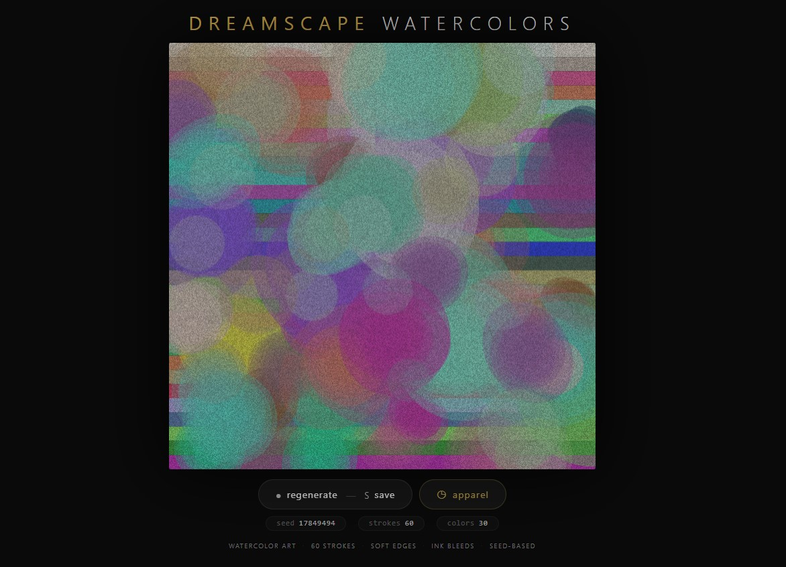
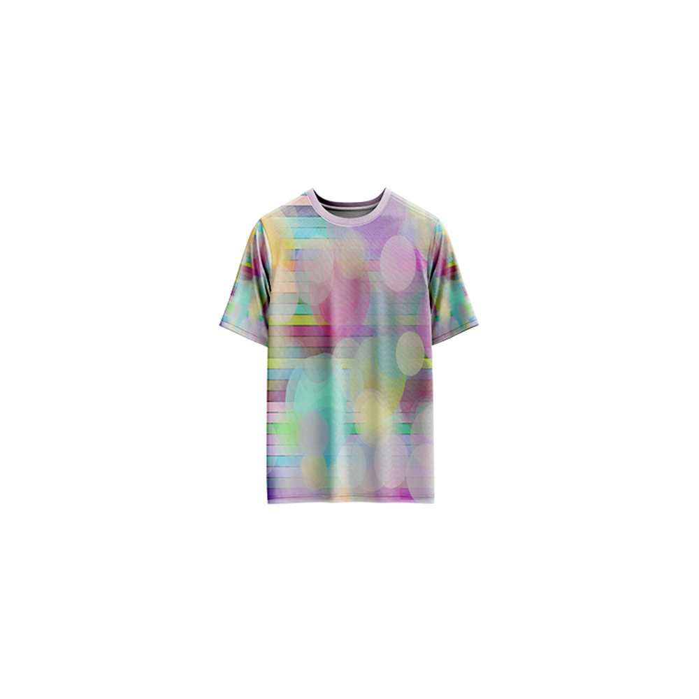

# Dreamscape Watercolors — Generative Art

[](https://reyrove.github.io/Dreamscape-Watercolors-Generative-Art)
[](https://opensource.org/licenses/MIT)

> **Generative watercolor art.** Each refresh creates a unique dreamy watercolor painting with soft-edged brush strokes, ink bleeds, glowing orbs, and paper texture.

## 🎨 Live Demo

<div align="center">
  <a href="https://reyrove.github.io/Dreamscape-Watercolors-Generative-Art" target="_blank">
    
  </a>
  <br><br>
  <a href="https://reyrove.github.io/Dreamscape-Watercolors-Generative-Art" target="_blank">
    
  </a>
  <br>
  <em>Click the image or button to experience the generative art</em>
</div>

## 👕 Apparel Preview

<div align="center">
  
  <br>
  <em>Dreamscape Watercolors artwork printed on a T-shirt</em>
</div>

## ✨ Features

- **Watercolor Strokes** — Soft-edged, feathered brush strokes
- **Ink Bleed Effect** — Organic ink spread around strokes
- **Segmented Background** — Horizontal color bands
- **Glowing Orbs** — Dreamy, luminous elements
- **Paper Texture** — Natural paper grain overlay
- **Rich Color Palette** — 30 random colors per artwork
- **Seed-Based** — Every composition is unique and reproducible via its seed
- **Save & Share** — Download as PNG with seed in filename
- **Apparel Mode** — Preview artwork on a T-shirt mockup
- **Responsive** — Works on desktop, tablet, and mobile
- **Pure JavaScript** — No external dependencies
- **Keyboard Shortcuts**:
  - `R` — Regenerate
  - `S` — Save image
  - `T` — Toggle apparel view

## 🎨 Artwork Details

| Parameter | Value | Description |
|-----------|-------|-------------|
| **Brush Strokes** | 60 | Number of watercolor strokes |
| **Colors** | 30 | Random color palette |
| **Dreamy Elements** | 20 | Glowing orbs |
| **Stroke Layers** | 7 | Feathered soft edges |
| **Paper Texture** | Yes | Noise-based grain |

## 🎯 How It Works

The artwork creates a dreamy watercolor painting using:

1. **Segmented Background**:
   - 30 horizontal color bands
   - Random soft colors

2. **Watercolor Strokes**:
   - 60 feathered brush strokes
   - 7 layers of decreasing size and opacity
   - Soft blur effect
   - Ink bleed edges

3. **Dreamy Elements**:
   - 20 glowing orbs
   - Soft shadow glow
   - Pastel colors

4. **Paper Texture**:
   - Noise-based grain overlay
   - Natural paper feel

## 🚀 Quick Start

### Local Development

```bash
# Clone the repository
git clone https://github.com/reyrove/Dreamscape-Watercolors-Generative-Art.git

# Navigate to the directory
cd Dreamscape-Watercolors-Generative-Art

# Open in browser
open index.html
# or use a live server
```

### Deploy to GitHub Pages

1. Push to GitHub
2. Go to Settings → Pages
3. Select branch `main` and root folder
4. Your site will be live at `https://reyrove.github.io/Dreamscape-Watercolors-Generative-Art`

## 🧠 How It Works

The artwork is generated using a deterministic random number generator, seeded by timestamp + random noise. Every refresh:

1. **Setup**:
   - Generates 30 random colors for background and strokes
   - Random positions, sizes, and colors for each element

2. **Background**:
   - 30 horizontal color bands create a soft gradient

3. **Watercolor Strokes**:
   - Each stroke is drawn with 7 feathered layers
   - Layers decrease in size and opacity
   - Blur effect simulates water spread
   - Ink bleed creates organic edges

4. **Dreamy Elements**:
   - Glowing orbs with shadow glow
   - Soft pastel colors

5. **Paper Texture**:
   - Noise overlay creates natural paper grain

## 📁 File Structure

```
Dreamscape-Watercolors-Generative-Art/
├── index.html                    # Main application (all-in-one)
├── Dreamscape-Watercolors.jpg    # T-shirt mockup image
├── fav.svg                       # Favicon
├── demo-screenshot.jpg           # Website demo screenshot
├── README.md                     # This file
└── LICENSE                       # MIT License
```

## 🛠️ Tech Stack

- **Pure Vanilla HTML/CSS/JS** — No dependencies
- **Canvas API** — 2D rendering
- **CSS Flexbox/Grid** — Responsive layout
- **GitHub Pages** — Hosting

## 🎯 Interactive Controls

| Action | Keyboard | Button |
|--------|----------|--------|
| Regenerate | `R` | Click "regenerate" |
| Save Image | `S` | Click "regenerate" |
| Toggle Apparel | `T` | Click "apparel" |

## 🎨 The Creative Process

### Watercolor Simulation
The artwork simulates watercolor through:
- **Feathered Edges**: Multiple layers with decreasing opacity
- **Blur Effect**: Soft blending between layers
- **Ink Bleed**: Organic spread around strokes
- **Paper Texture**: Natural grain overlay

### Color Palette
30 random colors are generated for each artwork, creating unique color harmonies. Colors are in the soft, dreamy range (50-255 RGB values).

### Dreamy Atmosphere
Glowing orbs with shadow blur create a dreamy, ethereal atmosphere. Pastel colors and soft edges contribute to the watercolor feel.

## 📱 Responsive Design

The application automatically adapts to:
- Desktop screens
- Tablets
- Mobile phones
- Landscape orientation
- Various aspect ratios

## 🤝 Contributing

Contributions are welcome! Feel free to:
- Fork the repository
- Create a feature branch
- Submit a pull request

### Ideas for Contributions:
- New watercolor techniques
- Additional color palettes
- Animation features
- Performance optimizations

## 📄 License

MIT License — see [LICENSE](LICENSE) file for details.

## 🙏 Acknowledgments

- Inspired by watercolor painting techniques
- Pure JavaScript implementation
- Special thanks to the creative coding community

---

**Built with ❤️ and dreamy watercolors**